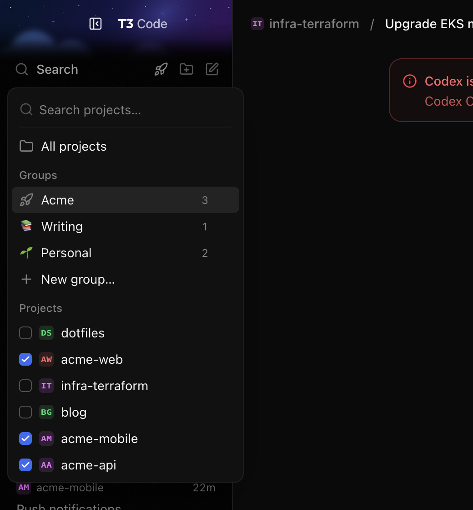
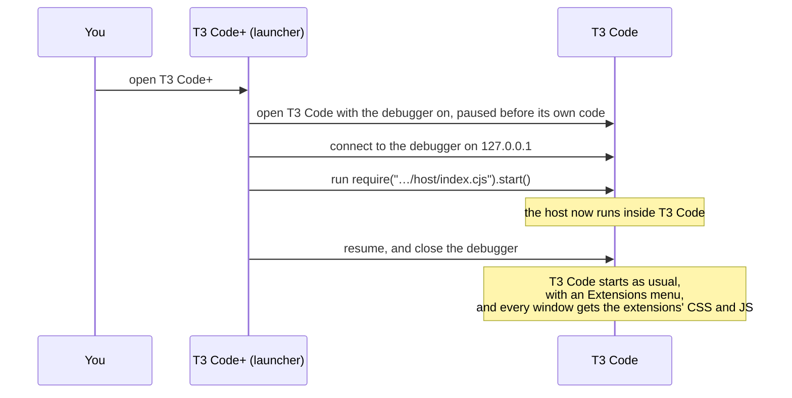

# t3-extensions

Add your own features to [T3 Code](https://t3.codes) ([source](https://github.com/pingdotgg/t3code)) on macOS, without forking it and without changing the installed app.

An extension is a folder with some CSS, some JavaScript, or both. You drop it in `~/.t3/extensions`, and it runs inside the official T3 Code you already use, which keeps its auto-updates and its code signature. An **Extensions** menu and an **Extensions** item in Settings let you turn extensions on or off, add them, and remove them.


> [!NOTE]
> This is an unofficial project. It is not made or supported by the T3 Code team. Extensions reach into T3 Code's interface, which can change in any release, so an update can break an extension.

## What extensions can do

The [`examples`](examples) folder has four extensions you can try in a minute:

| Extension | What it does |
| --- | --- |
| [Project Groups](examples/project-groups) | Filter the sidebar by several projects at once, and save them as named groups with an icon. |
| [Streaming Mode](examples/streaming-mode) | An eye button that blurs the names of your private projects, and their thread titles, while you stream or share your screen. Profiles choose which projects stay readable. |
| [Settle Boom](examples/settle-boom) | A small effect and a synthesized sound when a thread starts work, needs you, finishes, snoozes or wakes, and an explosion when you settle it. |
| [Thread Doom](examples/thread-doom) | Play Doom over a thread while its agent works. The game pauses when the agent needs you or finishes. |

<table><tr>
<td></td>
<td></td>
</tr></table>

## Quick start

You need macOS, T3 Code installed in `/Applications`, and Node.js 22 or later.

```sh
git clone https://github.com/nemesiscodex/t3-ext.git ~/t3-extensions
cd ~/t3-extensions
node bin/t3ext.cjs install-launcher
```

This builds a small app, **T3 Code+**, in `~/Applications`. From now on, open T3 Code+ (from Spotlight, or pin it to the Dock) instead of T3 Code. The launcher refers to this checkout by its path, so keep it where you cloned it.

The commands look for `/Applications/T3 Code (Nightly).app`. If your T3 Code is somewhere else or has another name, add `--app "/Applications/<name>.app"` to every command.

Try an example:

```sh
mkdir -p ~/.t3/extensions
ln -s "$PWD/examples/settle-boom" ~/.t3/extensions/settle-boom
```

Then choose **Extensions > Reload Window** in T3 Code, and settle a thread.

## How it works

**In one sentence:** T3 Code is an Electron app, and Electron includes a debugger, like the DevTools console in Chrome. The launcher opens that debugger, runs one line of code inside T3 Code, and closes the debugger again.

Think of a website open in Chrome. You can open DevTools, type JavaScript in the console, and change the page, while the website's server stays the same. T3 Code works the same way. Electron is Chrome plus Node.js, and it has the same kind of debugger. The launcher connects to it and types one line:

```js
require("/path/to/t3-extensions/host/index.cjs").start()
```

That line loads the **host**, the part of this project that runs inside T3 Code. From there, the host uses Electron's normal APIs, the same ones T3 Code uses for itself, to load your extensions.



If T3 Code is already running, the launcher does the same thing a different way. It sends the `SIGUSR1` signal, which tells Node to open its debugger, and then runs the same line. The open windows reload once so the extensions reach them.

### Why one line is enough

An Electron app has two layers:

- **The main process** runs Node.js with full access to your Mac. It creates every window and owns the menus, files and settings. The host runs here.
- **The windows** are web pages: the HTML, CSS and React you see. The main process can add CSS and JavaScript to them.

Getting code into the main process is the hard part. After that, the host adds each extension's `style.css` and `renderer.js` to every T3 Code window, adds the **Extensions** menu, and runs each extension's `main.js`.

### Why macOS allows it

| | |
| --- | --- |
| ✗ **Editing the app's files** | macOS checks the code signature of the files on disk. If one byte changes, macOS says the app "is damaged and can't be opened". |
| ✓ **Adding code in memory** | The signature covers the files, not what the app loads while it runs. The files never change, so the signature stays valid. |
| ✓ **The app allows the debugger** | Electron has build-time switches, called [fuses](https://www.electronjs.org/docs/latest/tutorial/fuses). One of them allows the debugger flags, and T3 Code ships with it on. The launcher checks it before doing anything. |
| ✓ **Same user, same Mac** | Your own programs can start your apps with flags and send them signals. No admin rights and no exploit are needed. |

**The catch:** this works only while T3 Code keeps that fuse on. If an update turns it off, T3 Code opens normally without extensions, and the launcher tells you why. It also means any program that runs as you could do the same thing. Many Electron apps turn the fuse off for that reason.

[docs/internals.md](docs/internals.md) has the full details: every state the launcher handles, the costs of loading late, how the launcher knows the host is loaded, and a map of the source.

## Why not fork T3 Code?

T3 Code is open source, so a fork is the obvious way to add features. We chose a separate launcher because a fork costs more than it first seems to.

| | Fork of T3 Code | t3-extensions |
| --- | --- | --- |
| **App you run** | Your own build, signed by you | The official T3 Code, unchanged |
| **Updates** | You merge every T3 Code release into the fork and ship a new build | T3 Code updates itself as usual, and extensions keep working |
| **Passkeys, keychain, auto-update** | Break unless you have T3's signing team, entitlements and provisioning profile | Keep working, because the app is still T3's |
| **macOS permissions** | A different app, so you grant microphone, camera and file access again | T3 Code keeps the permissions you already gave it |
| **Sharing a feature** | People switch to your build, and two forks cannot be combined | People drop a folder into `~/.t3/extensions`, and any extensions can run together |
| **Turning it off** | Reinstall the official app | Open T3 Code directly, or disable the extension |
| **Cost** | Changes can use T3's internal code directly | Extensions depend on T3's page structure and React internals, which are not a stable API |

The last row is the honest trade-off. A fork can change anything in T3 Code's source. An extension can only reach what the running app exposes, and a T3 Code release can move it. For features that sit on top of T3 Code, like the examples above, that is a good deal. For a deep change to how T3 Code works, send a pull request to T3 Code instead.

## Use it day to day

| Command | What it does |
| --- | --- |
| `node bin/t3ext.cjs install-launcher` | Builds `~/Applications/T3 Code+.app`. Add `--dry-run` to print the files without writing them. |
| `node bin/t3ext.cjs launch` | What T3 Code+ runs: starts T3 Code with extensions, or loads them into the running T3 Code, then brings it to the front. |
| `node bin/t3ext.cjs attach` | Loads extensions into the running T3 Code without bringing it to the front. Does nothing if they are already loaded. |
| `node bin/t3ext.cjs status` | Prints the T3 Code version, its pid, whether extensions are loaded, whether the fuse is on, and what is installed. It only reads. |
| `node bin/t3ext.cjs install-agent` | Installs a LaunchAgent that loads extensions again after T3 Code updates itself. |
| `node bin/t3ext.cjs uninstall-agent` | Removes that LaunchAgent. |

Run `node bin/t3ext.cjs` with no arguments for every option. Output goes to `~/Library/Logs/t3ext.log`, and you get a notification when something fails.

**After an update.** When T3 Code updates itself, it restarts without extensions. Run `install-agent` once, and extensions load again by themselves after each update.

**Opening T3 Code another way.** If you open T3 Code from the Dock, Spotlight or a `t3code://` link, it runs without extensions. Open T3 Code+ or run `attach` to load them.

## Write an extension

An extension is a folder in `~/.t3/extensions/<id>/`, or in `$T3CODE_HOME/extensions/` if you set `T3CODE_HOME`. The folder name is the extension id. Only `manifest.json` is required:

```json
{ "name": "My Extension", "version": "1.0.0", "description": "What it does" }
```

Add any of these optional files:

| File | Runs in | When |
| --- | --- | --- |
| `style.css` | every T3 Code window (`t3code://` pages only, never web pages in the preview browser) | each time a window loads |
| `renderer.js` | every T3 Code window | each time a window has loaded its HTML, which can be before React has rendered. Use a `MutationObserver` to wait for elements. |
| `main.js` | T3 Code's main process, with full Node.js and Electron access | once. Before T3's own code when T3 Code+ starts T3, or right away when extensions load into a running T3. |

If `main.js` exports a function, the host calls it with `{ id, dir, electron }`. Errors in any file are caught and shown in the extension manager, and T3 Code keeps running.

Style your UI with T3's CSS variables, such as `var(--background)`, `var(--foreground)`, `var(--border)` and `var(--primary)`, so it follows light and dark mode.

T3 Code windows have a `window.t3ext` object:

```js
await window.t3ext.list();                    // every extension, with enabled, parts and error
await window.t3ext.setEnabled("my-ext", false);
await window.t3ext.remove("my-ext");          // moves the folder to the Trash
await window.t3ext.add();                     // asks for a folder, then copies it in
await window.t3ext.openFolder("my-ext");      // or openFolder() for the extensions folder
await window.t3ext.getConfig("my-ext");       // the extension's saved config, or null
await window.t3ext.setConfig("my-ext", { theme: "dark" }); // saves it, resolves with what was saved
const stop = window.t3ext.onConfigChange((id, value) => {}); // after any setConfig, in every window
```

Changes to `style.css` and `renderer.js` apply when you reload the window (**Extensions > Reload Window**). Changes to `main.js` apply when you restart T3 Code through T3 Code+. Enabled state and config live in `~/.t3/extensions.json` as `{ "disabled": ["id", ...], "config": { "id": ... } }`.

**Know your own id.** `renderer.js` runs with a variable `extensionId` that holds its folder name. People link extensions in under any name, so use `extensionId` instead of writing the name in your code.

**Save settings with config.** A config is any JSON value. `setConfig` keeps what JSON keeps (as `JSON.stringify` does), and `null` deletes it. After a `setConfig`, every T3 Code window, the one that saved included, gets `onConfigChange` with the id and the saved value. Filter on your own id. Config survives disabling the extension, and is deleted when you remove it.

**Add a settings panel.** Register a function under your id, and the extension manager shows a **Settings** button on your row while the extension is on:

```js
(window.t3extSettings ??= new Map()).set(extensionId, (container, { close }) => {
  container.append(/* your controls */);
  return () => {}; // optional: runs when the panel closes
});
```

The manager calls the function with an empty element inside its dialog, and runs the returned cleanup when the person goes back, presses Escape or closes the manager. `close()` goes back to the extension list. To open your panel from your own UI, dispatch `new CustomEvent("t3ext:manage", { detail: { settings: extensionId } })` on `window`. Panels can use the manager's `t3ext-button` and `t3ext-switch` classes to match it. [Streaming Mode](examples/streaming-mode) has a full panel.

The panel map lives on `window` because `window.t3ext` is frozen. Config and panels need a host from this version on. After you update this checkout, reloaded windows get the new `renderer.js` files, but the host updates when T3 Code restarts through T3 Code+, so check that `window.t3ext.getConfig` exists before you use it.

**Develop with a symlink.** Keep your extension in its own repository and link it in:

```sh
ln -s ~/code/my-ext ~/.t3/extensions/my-ext
```

Edit, then reload the window. **Remove** in the manager moves only the link to the Trash, not your repository.

The examples show the common patterns: reacting to T3's own events ([Settle Boom](examples/settle-boom)), reading T3's state from React ([Project Groups](examples/project-groups), [Streaming Mode](examples/streaming-mode)), and using `main.js` to reach a frame from another origin ([Thread Doom](examples/thread-doom)).

The extension manager is itself an extension, in [`host/builtin/extension-manager`](host/builtin/extension-manager). You can disable it but not remove it. If you disable it, **Extensions > Manage Extensions…** offers to turn it back on.

## Security

- **Extensions have full access.** A `main.js` runs with the same rights as T3 Code, which can read your files and your agents' work. Install only extensions you trust, as you would with any program.
- **The debugger is open for about a second.** While the host loads, the debugger listens on `127.0.0.1` (never the network). Another program running as your user could connect in that window. Such a program could already do worse things to your account.
- **Nothing is installed in T3 Code.** Quit T3 Code and open it from the Dock, and it runs exactly as shipped.

## Known limits

- When you start T3 Code from the Dock, Spotlight, Finder or a `t3code://` link, it runs without extensions until you open T3 Code+ or run `attach`. After an auto-update, the LaunchAgent loads them, if you installed it.
- Loading into a running T3 Code reloads each open window once, and uses the fixed debugger port 9229. If another program holds that port, `attach` names the program and stops.
- If the launcher crashes after starting T3 and before connecting, T3 stays paused with no window. Quit it and launch again. The log says what happened.
- If a T3 Code release turns off the `EnableNodeCliInspectArguments` fuse, extensions cannot load. `launch` then starts T3 normally, and both `launch` and `attach` report why.
- The **Extensions** item in Settings depends on T3's settings sidebar markup. If a T3 update changes it, the **Extensions** menu still works.
- The LaunchAgent's command is tested by hand. A real launchd trigger on a real update has not been tested.

## Uninstall

```sh
node bin/t3ext.cjs uninstall-agent
rm -rf ~/Applications/"T3 Code+.app"
```

Optionally delete `~/.t3/extensions` and `~/.t3/extensions.json`. T3 Code itself was never changed.

## Contributing

```sh
npm test       # unit tests, no T3 Code needed
npm run e2e    # end-to-end tests against a temporary copy of your installed T3 Code
```

The end-to-end tests never touch the installed app. See [docs/internals.md](docs/internals.md#tests) for what they check. There are no dependencies to install.

New example extensions are welcome. Give each one a `README.md` that says what it does and how it finds what it needs in T3 Code, so readers can fix it when T3 changes.

## License

[MIT](LICENSE)
