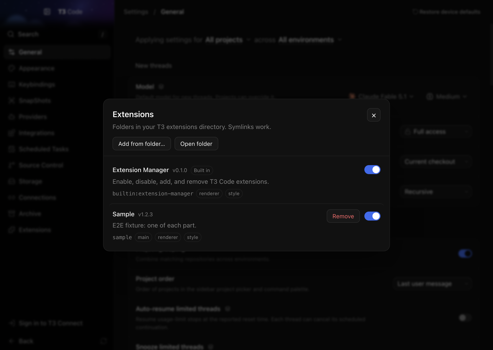

# t3-extensions

Load your own extensions into T3 Code on macOS without changing the T3 Code app.

You start T3 Code through a small launcher app, **T3 Code+**. The launcher starts the real T3 Code and loads an extension host into it, or loads the host into a T3 Code that is already running. The host then loads every extension folder in `~/.t3/extensions`. Each extension can add CSS and JavaScript to the T3 window, and it can run code in T3's main process. An **Extensions** menu and an **Extensions** item in Settings let you turn extensions on or off, add them, and remove them.



## How it works

`t3ext launch` (what T3 Code+ runs) and `t3ext attach` first check which of these states T3 Code is in, and act on it:

| T3 Code is | `launch` | `attach` |
| --- | --- | --- |
| not running | starts it with `--inspect-brk` and loads the host before T3's own code | does nothing (with `--wait <ms>`, first waits that long for T3 to start) |
| still starting | waits until macOS reports it finished launching, then checks again | same |
| running without the host | sends `SIGUSR1`, loads the host over the inspector on port 9229, then brings T3 to the front | the same, but never brings T3 to the front |
| running with the host | brings it to the front | does nothing |

Both commands hold a per-app lock while they act, so two launches at once start or attach only once. `launch` brings T3 Code to the front whenever it is running when `launch` ends, even after a failure.

### Starting T3 Code

The launcher runs `open -a "T3 Code (Nightly)" --args --inspect-brk=127.0.0.1:<random port>`. T3 Code then starts paused, before its own code runs. The launcher connects to the Node inspector on that port and calls `require("<this repo>/host/index.cjs").start()` inside T3's main process. Then it lets T3 continue and closes the inspector.

The T3 Code bundle is never modified. We tried patching `app.asar` first. Any edit inside the bundle breaks its code signature, and macOS then refuses to open the app ("is damaged and can't be opened"). Re-signing the app ourselves is not an option either: the app uses entitlements and a provisioning profile tied to the T3 team. Without them, passkeys, keychain access and auto-update break. `NODE_OPTIONS=--require` is also rejected: Electron ignores most `NODE_OPTIONS` in packaged apps. The inspector route needs no bundle edit, so updates and the signature stay intact. It only needs the `EnableNodeCliInspectArguments` Electron fuse, which T3 Code ships turned on.

The launcher starts T3 through LaunchServices (`open`), not as its own child process. So T3 stays its own "responsible process" for macOS privacy prompts, and its existing microphone, camera and file permissions keep applying.

### Attaching to a running T3 Code

T3 Code also starts without the launcher, from the Dock, Spotlight or a `t3code://` link, and when it restarts itself after an auto-update. For these, `t3ext attach` waits until macOS reports that T3 finished launching, because a `SIGUSR1` that arrives before Node installs its handler quits T3. Then it sends `SIGUSR1` to T3's main process. Node opens its inspector on `127.0.0.1:9229`. The launcher checks that the inspector belongs to that pid, calls `require("<this repo>/host/index.cjs").start()` through `Runtime.evaluate`, and closes the inspector again. The host then:

- reloads every open T3 Code window, so the preload adds `window.t3ext` and each extension's `style.css` and `renderer.js` load;
- sets T3's current application menu again, so the **Extensions** menu appears;
- runs the `main.js` of each enabled extension.

Attaching late has costs. Each open window reloads once. `main.js` runs after T3's own startup, not before it. The port is always 9229, because Node offers no other port for `SIGUSR1`. The inspector listens on it for about a second. If another program holds port 9229, attach stops with a message that names the program, and T3 keeps running without extensions.

Starting the host a second time does nothing, and the launcher checks for the host before it signals. The host listens on a Unix socket named after T3's pid (`t3ext-host-<pid>.sock` in your user temp folder) and answers with that pid. Only a live process can answer, so a socket left behind by a crashed T3 whose pid a new T3 reuses reads as "no host".

### What an update could break

Both routes need the `EnableNodeCliInspectArguments` Electron fuse, which T3 Code ships turned on. It is the one thing a T3 Code update could take away. `launch` and `attach` read the fuse from the app's Electron Framework binary first. If it is off, they stop with a message that says so. Neither `--inspect-brk` nor `SIGUSR1` would open the inspector then, and a `SIGUSR1` that T3 does not handle quits it. `launch` then opens T3 Code normally, without extensions. `t3ext status` shows the fuse.

## Install

You need this repository checked out somewhere permanent. The launcher app refers to it by absolute path.

```sh
node bin/t3ext.cjs install-launcher
```

This builds `~/Applications/T3 Code+.app` with T3's icon, and signs it ad hoc. Add `--dry-run` to print the files without writing them. Use `--app <path>` for a T3 Code that is not at `/Applications/T3 Code (Nightly).app`.

From now on, open **T3 Code+** (from Spotlight, or pin it to the Dock) instead of T3 Code. If T3 Code is already running without extensions, T3 Code+ loads them into it and brings it to the front.

T3 Code+ runs the launcher with T3's own binary in Node mode (`ELECTRON_RUN_AS_NODE=1`), so it does not depend on the Node.js in your shell. If that fails, it falls back to the `node` you ran `install-launcher` with. Launcher output goes to `~/Library/Logs/t3ext.log`. On failure you get a notification.

You can also launch from a terminal:

```sh
node bin/t3ext.cjs launch
```

To load extensions into the running T3 Code without bringing it to the front:

```sh
node bin/t3ext.cjs attach
```

### Re-attach after updates

When T3 Code updates itself, it restarts without extensions. The LaunchAgent puts them back:

```sh
node bin/t3ext.cjs install-agent
```

This writes `~/Library/LaunchAgents/dev.t3ext.reattach.plist` and loads it with `launchctl bootstrap gui/$UID`. The agent watches T3's `Contents/Info.plist`, which an update replaces. When the file changes, the agent runs `t3ext attach --wait 120000`. That waits up to two minutes for T3 to start again, then attaches. Within those two minutes it also keeps waiting if T3 quits and starts again, and retries while the update is still replacing files. If T3 does not start in that time (for example, it updated while closed), the agent exits quietly. It never brings T3 to the front, and it does nothing when the host is already loaded. It runs on T3's own binary as Node, like T3 Code+. While an update is still replacing the app, it retries for about 30 seconds, then uses the `node` you ran `install-agent` with. Both first read T3's `RunAsNode` fuse with that `node`: with the fuse off, T3's binary would start the T3 app instead of Node, so they skip it. Output goes to `~/Library/Logs/t3ext.log`. You get a notification only when attaching fails. Add `--dry-run` to print the plist and the `launchctl` commands without running them.

The tests check the plist and run the agent's command by hand. A real launchd trigger on a real update has not been tested. The agent does not react to a start from the Dock, Spotlight or a link. Run `t3ext attach`, or open T3 Code+, to load extensions then.

To remove the agent:

```sh
node bin/t3ext.cjs uninstall-agent
```

### Check the setup

```sh
node bin/t3ext.cjs status
```

This prints the T3 Code version, its pid, whether the extension host is loaded, whether the inspect fuse is on, and whether the LaunchAgent and T3 Code+ are installed. It only reads, and never signals T3.

## Write an extension

An extension is a folder in `~/.t3/extensions/<id>/`, or in `$T3CODE_HOME/extensions/` if you set `T3CODE_HOME`. The folder name is the extension id. Only `manifest.json` is required:

```json
{ "name": "My Extension", "version": "1.0.0", "description": "What it does" }
```

Add any of these optional files:

- `style.css` is inserted into every T3 Code window (`t3code://` pages only; never into web pages in the preview browser).
- `renderer.js` runs in every T3 Code window after the page has loaded its HTML, which can be before React has rendered. Use a `MutationObserver` to wait for elements. Errors are caught and logged with the extension id.
- `main.js` runs once in T3's main process. It runs before T3's own code when T3 Code+ starts T3, and right away when the host attaches to a running T3. If it exports a function, that function is called with `{ id, dir, electron }`. An error is caught and shown in the extension manager; T3 keeps running.

Style your UI with T3's CSS variables, such as `var(--background)`, `var(--foreground)`, `var(--border)` and `var(--primary)`, so it follows light and dark mode.

T3 Code windows have a `window.t3ext` object:

```js
await window.t3ext.list();                    // every extension, with enabled, parts and error
await window.t3ext.setEnabled("my-ext", false);
await window.t3ext.remove("my-ext");          // moves the folder to the Trash
await window.t3ext.add();                     // asks for a folder, then copies it in
await window.t3ext.openFolder("my-ext");      // or openFolder() for the extensions folder
```

Changes to `style.css` and `renderer.js` apply when you reload the window (**Extensions > Reload Window**). Changes to `main.js` apply when you restart T3 Code through T3 Code+.

Enabled state lives in `~/.t3/extensions.json` as `{ "disabled": ["id", ...] }`.

### Develop with a symlink

Keep your extension in its own repository and link it in:

```sh
ln -s ~/code/my-ext ~/.t3/extensions/my-ext
```

Edit, then reload the window. **Remove** in the manager moves only the link to the Trash, not your repository.

### The built-in extension manager

The manager is itself an extension, in `host/builtin/extension-manager`. You can disable it but not remove it. If you disable it, **Extensions > Manage Extensions…** offers to turn it back on. The settings item is added on a best-effort basis by matching T3's settings sidebar. If a T3 update changes that sidebar, the menu keeps working.

## Uninstall

Run `node bin/t3ext.cjs uninstall-agent` if you installed the agent. Delete `~/Applications/T3 Code+.app`, and optionally `~/.t3/extensions` and `~/.t3/extensions.json`. T3 Code itself was never changed.

## Known limits

- When you start T3 Code from the Dock, Spotlight, Finder or a `t3code://` link, it runs without extensions until you open T3 Code+ or run `t3ext attach`. After an auto-update, the LaunchAgent attaches them, if you installed it.
- While the host loads, the inspector listens on `127.0.0.1` for about a second. Another program running as your user could connect in that window. Such a program could already do worse things to your account.
- If the launcher crashes after starting T3 and before connecting, T3 stays paused with no window. Quit it and launch again. The log says what happened.
- If a T3 Code release turns off the `EnableNodeCliInspectArguments` fuse, the launcher cannot load the host. `launch` then starts T3 normally without extensions, and both `launch` and `attach` report why.
- The settings item depends on T3's sidebar markup (`ul[data-sidebar="menu"]` containing an "Appearance" item).

## Tests

```sh
npm test       # unit tests: registry, CLI, LaunchAgent plist, fuse reader, host presence, launch race (starts a fake app)
npm run e2e    # clones the installed app into a temp dir and drives it over CDP: test/e2e.cjs, then test/e2e-attach.cjs
```

The end-to-end tests never touch the installed app. Each makes an APFS clone of the app in a temp directory, isolated with its own `HOME` and `T3CODE_HOME`. `test/e2e.cjs` opens the clone through a T3 Code+ built in the temp directory, and checks the sample extension in `test/fixtures/sample`, the menu, the manager and the settings item. `test/e2e-attach.cjs` opens the clone without the launcher, then checks `attach` (including with port 9229 taken), a second `attach`, `launch`, `status`, and the LaunchAgent's command waiting for the clone to start. When they finish, they kill every process running from the temp directory. `test/e2e.cjs` rewrites `docs/*.png`.
