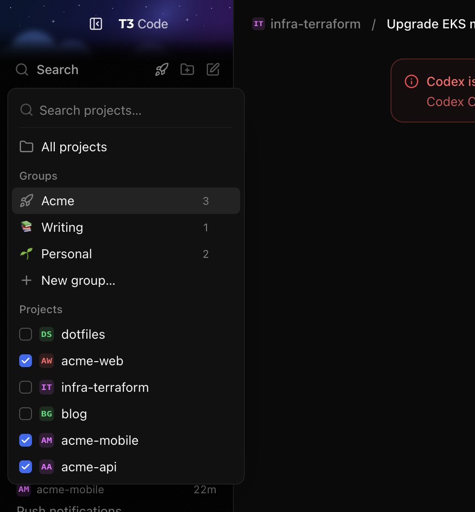

# Project Groups

T3's sidebar filter can hold several projects, but its menu adds them one shift-click at a time and cannot save a set. This extension lets you check several projects at once, and save a selection as a named group with an icon, such as "Acme" with a rocket for three client repositories. The sidebar then shows only the threads of those projects.



## What it does

The filter button next to the sidebar search opens a menu with:

- **Search projects…** to narrow the list. Typing on any row also types here.
- **All projects** to clear the filter.
- **Groups**: each group with its icon, its number of projects and an edit button. Click a group to filter by it. **New group…** opens the group editor.
- **Projects**: every project with a checkbox and a settings button. Checking projects filters by all of them at once. The settings button, or a right-click on the project, opens T3's settings for that project, as in T3's own menu. If a group is active, checking or unchecking a project starts a new selection from that group's projects.
- **Save as group…** when two or more projects are checked.

The group editor asks for a name, an icon and the projects. **Search projects…** above the project list narrows it by name; checked projects stay checked while the search hides them. The icons and emoji are the same ones T3 offers for a project icon. **Delete** removes an existing group; click it twice to confirm. Deleting the active group shows all projects again.

The button shows the active filter: T3's filter icon for all projects, the group's icon for a group, the project's icon for one project, and a small count for several projects. Its tooltip names the filter, such as "Filter threads by project: Acme".

Keyboard: Enter, Space or Down on the button opens the menu. Up and Down move between rows, Enter or Space picks a row, Right moves to a group's edit button or a project's settings button, and Escape closes the menu. In the editor, Enter in the name saves, Enter in the project search checks or unchecks the first match, and Escape cancels; with text in the project search, the first Escape clears it.

The groups and the filter are saved in the window's `localStorage` under `t3ext.project-groups`, so they survive a reload. Other open T3 windows pick up a change through the `storage` event.

## How it knows

**Projects come from T3's sidebar.** The extension reads three things from the React fiber of T3's filter button (`aria-label` starting with "Filter threads by project"): the button's own props (`items`, `onValueChange`), the sidebar's memoized project list (`projectGroups`, with each project's `memberProjectRefs`), and the zustand store that holds T3's filter as `sidebarProjectScopeKeys`. zustand's hook keeps the store in a `useCallback`'s deps, so the store is found among the sidebar's hooks. A project is saved as `<environmentId>:<projectId>`, so groups keep working if you change T3's project grouping setting.

**T3's own filter does the work.** The extension sets T3's filter to the selected projects: first through T3's own menu handler, as if the first project were picked there, which also clears T3's thread selection and scrolls the list to the top; then the whole set through the store. Everything then behaves as T3's own filter: the thread list, sidebar search, **Settled (N)**, the ⌘1–⌘9 jump labels and **New thread**. T3 filters by whole projects, so a group that holds only some of a project's member projects, saved under another grouping setting, shows the whole project; its checkbox in the menu shows a dash.

**T3's own changes win.** When T3 changes its filter itself, the extension follows. That happens with the thread menu's **Filter by <project>**, and when you open a thread outside the filter, which makes T3 clear it. This was checked by calling T3's menu handler directly, with and without Shift, because a script cannot open T3's native thread menu.

**It fails open.** If a T3 update renames what the extension reads, it leaves T3's filter button as it is, and logs one warning with `[project-groups]` in the console.

## Controls

In the window's DevTools console:

```js
t3ProjectGroups.state;                        // { version, groups, filter }
t3ProjectGroups.groups;                       // [{ id, name, icon, projects }]
t3ProjectGroups.catalog();                    // T3's projects: { key, name, icon, refs }
t3ProjectGroups.setFilter({ kind: "all" });
t3ProjectGroups.setFilter({ kind: "group", id: t3ProjectGroups.groups[0].id });
t3ProjectGroups.setFilter({ kind: "projects", projects: t3ProjectGroups.catalog()[0].refs });
t3ProjectGroups.resolve();                    // what the filter asks T3 for: { keys, label, group, chosen }
t3ProjectGroups.open();                       // opens the menu
```

## Icons

The lucide icon data in `renderer.js` is generated from T3's own bundle, so the picker matches T3's. After a T3 update, regenerate it from this folder:

```sh
ELECTRON_RUN_AS_NODE=1 "/Applications/T3 Code (Nightly).app/Contents/MacOS/T3 Code (Nightly)" scripts/icons.cjs
```

T3's binary runs the script as Node, because plain Node cannot read inside `app.asar`. With a folder of T3's client assets already extracted, `node scripts/icons.cjs <folder>` works too.

The icons are from [Lucide](https://lucide.dev), ISC license, Copyright (c) Lucide Contributors.
