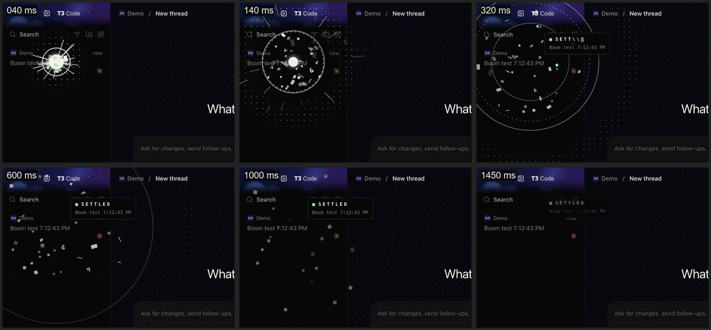

# Settle Boom

When a thread settles, this extension sets off a small explosion where its sidebar row was, with a synthesized boom. The look and sound follow Kit Langton's [Effect Institute](https://www.effect.institute/): off-white ink on black, a dot grid, thin rings, glitch glyphs, small green squares, and Tone.js-style voices.



## What it does

1. **Flash:** a white core flashes.
2. **Rings:** three thin rings expand, the middle one dashed and turning.
3. **Dot grid:** a shock wave lights up a dot grid as it passes.
4. **Debris:** sparks streak out, and glyphs fly out, flicker through `@#$%&*/=-+?!~<>\|█▓▒░` and cool into squares.
5. **Label:** a "■ SETTLED" label with the thread's title resolves letter by letter, then blurs away.
6. **Shake:** the window shakes slightly.

The sound has three parts:

- **Blast:** a filtered noise burst and a sub thump.
- **Stab:** Effect Institute's distorted, detuned-saw "death" stab and low rumble.
- **Chime:** its triangle "success" triad, C5, E5 and G5, through reverb.

With **Reduce motion** on in macOS, only one ring, the label and the sound play.

It fires for every settle: the Settle button, a menu, a keyboard shortcut, auto-settle, or an agent settling through T3's tools.

## How it knows

T3's server sends the window a `thread.updated` message whose `thread.settledAt` is set. The window's connection opens before `renderer.js` runs, so the extension reads messages through the `MessageEvent` `data` getter instead of adding a listener. The getter runs inside T3's own message handler. It explodes only for a `settledAt` it has not seen and that is less than 30 seconds old, so reloads and old settled threads stay quiet.

**Where it explodes:** a click removes the row before the server answers, so the extension remembers rows as you press, right-click or focus them. When a thread settles without that, for example through auto-settle, the row is still on screen when the message arrives. Rows are found by `data-thread-item="<environmentId>:<threadId>"`. If a T3 update renames that attribute, the explosion falls back to the middle of the window.

## Controls

In the window's DevTools console:

```js
t3SettleBoom.play();                         // try it in the middle of the window
t3SettleBoom.play({ x: 120, y: 140, title: "Fix the build" });
t3SettleBoom.muted = true;                   // saved in localStorage
await t3SettleBoom.renderSound();            // the sound as an AudioBuffer, rendered offline
```
