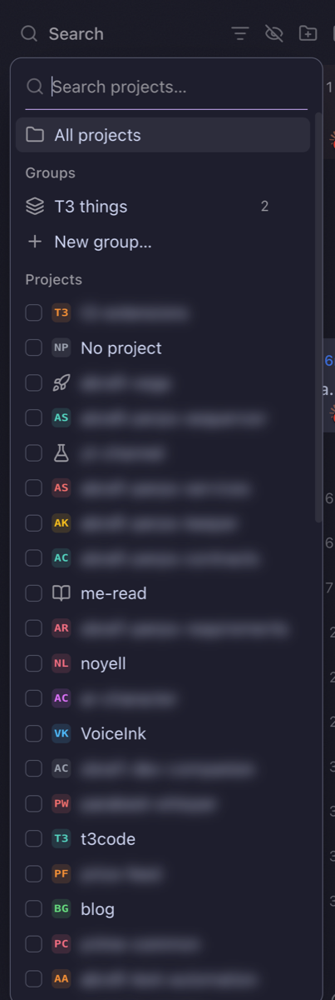

# Streaming Mode

When you stream or share your screen, you may not want viewers to read the names of your private projects. This extension adds an eye button next to the sidebar's project filter. While it is on, the name of every project whose GitHub repository is not public is blurred. Names of public repositories stay readable.



## What it does

Click the eye after the filter icon. It turns into a crossed-out eye in T3's accent color, and these are blurred wherever one of them is the whole text of an element, such as the sidebar rows, the project name in the header breadcrumb and the Project Groups menu:

- the project's name in the sidebar,
- its folder name and its path,
- its repository as `owner/name` and as `github.com/owner/name`.

Click the eye again to show every name.

Right-click the eye to ask GitHub again about every repository, for example after you make one public. The eye pulses while it checks, and its tooltip then says when it last checked, or that GitHub's rate limit stopped some checks and when you can try again. The setting is saved in the window's `localStorage` under `t3ext.streaming-mode`, so it survives a reload, and other open T3 windows follow it through the `storage` event.

## How it knows

**Projects come from T3's sidebar.** The extension reads the sidebar's memoized project list from the React fiber of T3's filter button (`aria-label` starting with "Filter threads by project"). Each project there carries T3's `repositoryIdentity`, which T3 takes from the `origin` remote, with the GitHub owner and name.

**GitHub says what is public.** For each `github.com` repository the extension calls `https://api.github.com/repos/<owner>/<name>` without logging in. GitHub answers 200 with `"private": false` for a public repository, and 404 for a private one, so a private repository you can read yourself still counts as private. The answer is kept for a day, then checked again. A right-click on the eye checks every repository at once.

**Anything not known to be public is blurred.** This covers a project with no remote, a remote that is not on github.com, a repository GitHub has not answered for yet, and a check that failed offline or hit the rate limit. GitHub allows 60 calls an hour without a login. When it answers with a rate limit, checks pause until the time GitHub gives.

**Names never flash.** A `MutationObserver` marks each new or changed text before the next paint. A name split over several nodes, as when sidebar search highlights the matched part, is matched on the element that holds all of it.

**It works with the sidebar collapsed.** The extension keeps the last list of names it blurred, so the header breadcrumb stays blurred while T3's filter button, and with it the project list, is not on screen.

## Known limits

- Only text that is exactly a project name, path or repository is blurred. A name inside a longer text is not: a thread title, a chat message, a command or a file path in a tool call.
- Project icons stay visible, including T3's two-letter monograms.
- Native `title` tooltips are not blurred, such as Project Groups' "Filter threads by project: Acme".
- A repository you make private shows its name until its answer is checked again, after a day or when you right-click the eye.
- A right-click costs one of GitHub's 60 calls an hour per repository. With about 40 repositories, a second right-click within the hour runs into the limit, and the repositories it could not check keep their previous answer.
- If a T3 update renames what the extension reads, it keeps blurring the names it last saw, misses new projects, and logs one warning with `[streaming-mode]` in the console.

## Controls

In the window's DevTools console:

```js
t3StreamingMode.on;              // true while names are blurred
t3StreamingMode.on = true;       // same as clicking the eye
t3StreamingMode.repos;           // { "github.com/owner/name": { public, checkedAt } }
t3StreamingMode.secrets;         // every text that is blurred
await t3StreamingMode.refresh(); // same as right-clicking the eye: { at, total, answered, limited, failed }
```
